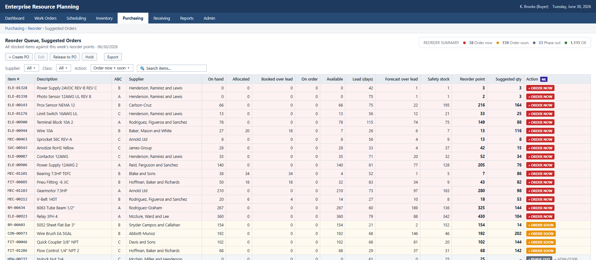
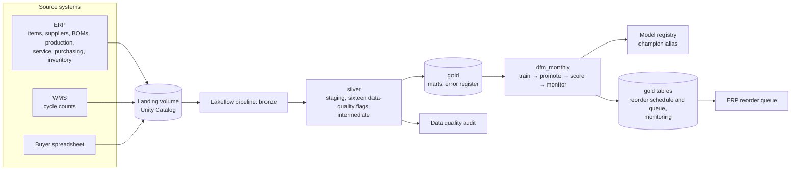

# Machine Learning Model: Demand Forecasting 

This project was built on Azure Databricks: source extracts land in Unity Catalog, a Lakeflow pipeline cleans and transforms them, and a monthly job trains, gates, scores and monitors the model through MLflow and the Unity Catalog model registry. All code related to data and ML engineering is found below in the Code section. 

The work began with a full [data quality audit](https://bmdvs.github.io/demand-forecasting-ml/docs/reports/data_quality_audit.html) of the shop's ERP, which found sixteen recurring error types across eight tables and remediated them so the records could be trusted.

A **demand forecasting ML model** was then built on the cleaned records. Every week it forecasts demand and sets the reorder decision for each of the shop's 1,300 stocked items. The model's code is found [here](src/dfm/). The model is detailed in the [model overview](https://bmdvs.github.io/demand-forecasting-ml/docs/reports/model_overview.html) and summarized below.

- **Results.** The model has set every reorder decision the shop made in 1H 2026 (January to June 2026). The table compares that period with 2025, when buyers reordered by hand on the uncleaned records, and shows the same manual process run on the cleaned records over 1H 2026. The model significantly improved every production and purchasing KPI. Both methods carried less inventory than 2025, driven by recomputed reorder points and safety stock as a result of the data quality audit.
  
<div align="center">

<b>Performance of ML-driven Reordering vs. Manual Reordering on Cleaned ERP Records (1H 2026 against Avg. 1H/2H 2025)</b>

| | Stockout days | Jobs held for material | Rush-freight spend | Avg. inventory balance |
|:---|:---:|:---:|:---:|:---:|
| Manual reordering | −7% | −10% | −19% | −11% (139 days of usage, from 161) |
| **ML-driven reordering** | **−36%** | **−43%** | **−46%** | **−5% (148 days of usage, from 161)** |

</div>

- **Purpose and use.** Every Monday the model forecasts each item's usage over its supplier lead time and turns it into a reorder point (the stock level at which to order) and an order quantity, written to the ERP's purchasing screen. A buffer is added from the item's forecast error, its supplier's lead-time variability and a fill-rate target set by criticality. The model is intended to be used by buyers as their default weekly reorder queue, with every line open to review and override.
- **Model training.** The model was trained on three years of remediated ERP history: inventory transactions, production orders and bills of materials, service orders, purchase-order receipts, and the item and supplier masters.
  - It takes the parts that booked jobs will draw as known, and forecasts the rest of each item's usage: mainly floor pulls, service issues and jobs not yet booked.
  - That forecast is driven by the item's own usage history, expressed as lagged and rolling features computed up to the forecast date, plus demand pattern variability and calendar seasonality
  - A random forest is trained across all items on these features together with each item's demand pattern, class, lead time and annual volume. 
- **Model evaluation.** Candidates (ridge, random forest, XGBoost) were tuned with Optuna on a validation window, selected by rule, and scored on a held-out 2025 backtest.
  - Seven baseline methods were computed, the strongest being the moving average by demand pattern (47.2% WAPE).
  - The production model reaches 43.0% overall and 37.1% on line-critical parts, an 8.9% reduction in error against baseline.
  - Most of the remaining error sits in the lumpy and intermittent items, about two-fifths of the catalog, with demand that arrives in a few weeks a year; no tested method could forecast those at low error.
  - Full evaluation and technical detail are in the [technical report](https://bmdvs.github.io/demand-forecasting-ml/docs/reports/technical_report.html).
- **Production monitoring.** Retrained monthly and refreshed weekly, with a monitor that tracks forecast error and bias by demand pattern, feature drift, supplier lead-time drift and data quality against investigate-and-retrain thresholds.
  - Full monitoring detail is in the [monitoring report](https://bmdvs.github.io/demand-forecasting-ml/docs/reports/monitoring_report.html).

The model's reorder suggestions are embedded in the shop's existing ERP purchasing screen and ranked by urgency:

[](https://bmdvs.github.io/demand-forecasting-ml/docs/index.html)

---

## Business Context

An industrial equipment manufacturer (~$30mm revenue) produces conveyors and material-handling modules, industrial mixers and agitators, and custom enclosures and frames. It stocks about 1,300 items purchased from 40 suppliers. 

Historically, the shop's inventory reordering was done manually and ran on data that was messy and couldn't be trusted. Much of the reordering process was labor-intensive and imprecise: stock levels and lead times were stale, stock on hand was unverified, safety stock was inflated, and rush orders were relied upon to compensate for shortfalls. The result was the shop carrying excess inventory, 161 days of usage, yet still logging elevated stockout days, held jobs for missing material, and rush freight spend.

---

## Deliverables

| # | Deliverable | What it is | Links |
|---|---|---|---|
| 1 | ERP reorder queue | The demand forecasting model embedded in the ERP's purchasing screen: each item's on-hand, allocated, on-order and available stock, booked requirements over its lead time, forecast usage over its lead time, safety stock, reorder point, and suggested order quantity. | [View](https://bmdvs.github.io/demand-forecasting-ml/docs/index.html) |
| 2 | Data quality audit | Details the data quality audit, including every type of error found across the ERP's eight tables, the error remediation completed, the before-and-after results, and the process changes that will keep the ERP system clean. | [View](https://bmdvs.github.io/demand-forecasting-ml/docs/reports/data_quality_audit.html) |
| 3 | ML model overview & performance report | A high-level summary of the demand forecasting model: what it does, the data it learns from, how it sets each reorder, and the results it achieves. | [View](https://bmdvs.github.io/demand-forecasting-ml/docs/reports/model_overview.html) |
| 4 | ML technical report | The model card, training data and time-based split, model selection and performance, the feature study, SHAP feature importance, how forecasts turn into reorder decisions, known limitations, and deployment. | [View](https://bmdvs.github.io/demand-forecasting-ml/docs/reports/technical_report.html) |
| 5 | MLOps monitoring report | Monthly monitoring of the live model's outcomes against retraining thresholds: forecast error and bias overall and by demand pattern, drift, data quality, business KPIs, and the supplier lead-time review. | [View](https://bmdvs.github.io/demand-forecasting-ml/docs/reports/monitoring_report.html) |

---

## Code

### ML model

| Folder | What it is |
|---|---|
| [`src/dfm/`](src/dfm/) | The model package: features, training and selection, the reorder policy, the promotion gates and the monitor, with the monthly job's entry points (train, promote, score, monitor) in `entrypoints/`. |

### Data & ML engineering

| Folder | What it is |
|---|---|
| [`pipelines/`](pipelines/) | The Lakeflow pipeline in SQL: bronze (the landed extracts), silver (staging, the sixteen data-quality flags and the intermediate models), gold (the marts the model reads and the audit's error register), and integrity checks. |
| [`infra/`](infra/) | Platform setup and maintenance: Unity Catalog objects and grants, extract landing, data profiles and the gold snapshot export ([setup notes](infra/README.md)). |
| [`infra/bundle/`](infra/bundle/) and [`databricks.yml`](databricks.yml) | The Databricks Asset Bundle: the pipeline and the monthly job `dfm_monthly`, with dev and prod targets. |
| [`src/tests/`](src/tests/) | Unit tests for the package, and the local parity runner in [`src/tests/parity/`](src/tests/parity/) that checks the platform's tables and model outputs against the archived reference run. |
| [`data_source/`](data_source/) | The data generators and sample extracts from the ERP, warehouse system and buyer's spreadsheet. |

---

## How it works



The extracts from the ERP, its warehouse system and the buyers' spreadsheet are landed in a Unity Catalog volume and built by a Lakeflow pipeline into bronze, silver and gold tables. In silver, one data-quality flag per error type marks the affected records, which the audit reads through the gold error register. The monthly job trains the model on the gold tables, promotes a new version only when its gates pass, scores the weekly reorder points and order quantities into the gold tables the ERP's reorder queue reads, and monitors the schedule in force.

---

## Data

The datasets were generated to represent typical records from a manufacturing ERP, its warehouse system and a buyer's spreadsheet, with error types and rates constructed to reflect patterns commonly documented in these systems, so the full workflow can be demonstrated on data that is safe to share publicly; the extracts are landed as Parquet in a Unity Catalog volume. The [generators are in `data_source/generate/`](data_source/generate/).

---

## Running it

The source data is generated locally in two passes: the first builds three years of history, and the second replays January to June 2026 on the reorder schedule the model issued. The pass-1 outputs are saved before the second pass regenerates the files.

```bash
# Local
python -m venv .venv
source .venv/bin/activate          # Windows: .venv\Scripts\activate
pip install -e . -e src

# 1. Generate the source data and remediate it (pass 1)
python -m data_source.generate.run_generator
python -m data_source.generate.validate
python -m data_source.generate.remediation
python -m data_source.generate.export_truth
mkdir -p runs/seq/pass1/data_source && cp -r data_source/raw data_source/truth runs/seq/pass1/data_source/

# 2. Land the extracts in the Unity Catalog volume (pass 1 now, pass 2 after the replay)
python infra/land_extracts.py --profile <profile> --pass pass1

# 3. Pass 2: replay January to June 2026 on the schedule the model issued (the generator replays on the schedule in ml/data/policy/ when one is present), then land the replayed extracts
python -m data_source.generate.run_generator
python -m data_source.generate.validate
python -m data_source.generate.remediation
python -m data_source.generate.export_truth
python infra/land_extracts.py --profile <profile> --pass pass2

# 4. Local parity runner: the package on the archived reference, against the platform's outputs
python src/tests/parity/run_package.py --archive reference/2026-10_post_signal_update --out runs/parity/package/archive_pass2
python src/tests/parity/parity_b.py --reference reference/2026-10_post_signal_update --run runs/parity/package/archive_pass2

# 5. Report generators, from the gold snapshot (the audit also reads the two local analyses)
python -m docs.build.reliability
python -m docs.build.financials
python -m docs.build.generate_data_quality_audit
python -m docs.build.generate_reorder_queue
python -m docs.build.generate_model_overview
python -m docs.build.generate_technical_report
python -m docs.build.generate_monitoring_report
```

```bash
# Databricks
# 1. Unity Catalog objects and the deploy service principal's grants
DFM_STORAGE_ACCOUNT=<account> infra/unity_catalog.sh <profile>
DFM_DEPLOY_SP=<application id> infra/grant_deploy_sp.sh --apply

# 2. Deploy the pipeline and the monthly job, then run it (pipeline update, train, promote, score, monitor)
databricks bundle deploy -t prod
databricks bundle run dfm_monthly -t prod

# 3. Data profiles, once the first run has written the tables; then the gold snapshot for the reports
infra/data_profiles.sh
python infra/export_gold_snapshot.py --profile <profile> --issued-run <job run id> --monitor-run <job run id> \
    --version gold.weekly_backtest=<n> --version gold.reorder_schedule=<n> --version gold.reorder_queue=<n>
```

The report generators write standalone HTML to [`docs/`](docs/), which GitHub Pages serves. Setup details, deployment and the first-run steps are in [`infra/README.md`](infra/README.md).

---

## Stack

| Layer | Tools |
|---|---|
| Storage & governance | Unity Catalog, Delta Lake |
| Transformation & data quality | Lakeflow Declarative Pipelines |
| Model lifecycle | MLflow, Unity Catalog model registry |
| Monitoring | Databricks data profiling |
| Deployment | Databricks Asset Bundles, GitHub Actions |
| Modeling | scikit-learn, XGBoost, Optuna, SHAP |
| Reporting | matplotlib, static HTML |
| Delivery | GitHub Pages |

---

[Brian Davis](https://github.com/bmdvs). Data engineering and applied analytics/ML for manufacturers.
